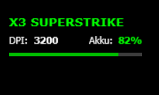

# Logitech G PRO X3 SUPERSTRIKE – Rainmeter Profile & Battery

A small open-source Rainmeter skin for the **Logitech G PRO X3 SUPERSTRIKE**. It shows the mouse battery level and the currently active onboard profile, and lets you switch between **Onboard Profile 1** and **Onboard Profile 2** by clicking the skin.

After the two onboard profiles have been configured once, **Logitech G HUB does not need to keep running**.

## Preview



> The screenshot above is from the original local test setup and shows the DPI value. The public v1.0 skin is generalized: it displays **Profile 1** or **Profile 2** instead of assuming fixed DPI values. Your DPI and all other mouse settings remain whatever you saved in those profiles.

## What it does

- Shows the active onboard profile: **1 or 2**
- Shows the battery percentage and a battery bar
- Click anywhere on the skin to switch **Profile 1 ↔ Profile 2**
- Refreshes profile / battery status every 5 minutes
- Does not require G HUB to remain open after setup
- Does not run a permanent helper process; the helper starts only for a status refresh or profile switch
- Source code and build script are included

## Important: this does not set your DPI

The tool switches between two profiles already stored in the mouse. It does **not** force 1600 DPI, 3200 DPI, or any other DPI value.

For example, you could configure:

- **Profile 1:** your gaming settings (for example 1600 DPI)
- **Profile 2:** your desktop settings (for example 3200 DPI)

Those numbers are only examples. You can use whatever DPI, polling rate, LOD and other settings you prefer.

# Quick start – normal users

## 1. Configure the two profiles once in Logitech G HUB

1. Open **Logitech G HUB**.
2. Select the **G PRO X3 SUPERSTRIKE**.
3. Configure the settings you want for your first profile.
4. Save that configuration to **Onboard Profile / Slot 1**.
5. Configure your second set of settings.
6. Save it to **Onboard Profile / Slot 2**.
7. Make sure both profiles are stored in the mouse's onboard memory.
8. Close G HUB before using the Rainmeter switcher.

Only Profile 1 and Profile 2 are used by this project. Profiles 3–5 are not touched.

## 2. Install the Rainmeter skin

For a normal release, download the latest `.rmskin` file from the repository's **Releases** page and double-click it. Rainmeter's installer will open; install the skin and load `X3Superstrike.ini` if it is not loaded automatically.

> If you downloaded the source code instead of a `.rmskin` release, see **Build from source** below.

## 3. Use it

The skin displays something like:

```text
X3 SUPERSTRIKE
Profile: 2        Battery: 82%
████████████████
```

Click anywhere on the skin to switch to the other onboard profile. Click again to switch back.

The display may take around 1–2 seconds to update after a click.

# Tested hardware

This version was developed and tested with:

- Logitech G PRO X3 SUPERSTRIKE
- USB receiver VID `046D`, PID `C54F`
- HID++ vendor interface usage page `FF43`, usage `0302`
- Windows 11
- Rainmeter

It is **not claimed to support other Logitech mice or receiver revisions**. If your hardware differs, do not assume compatibility.

# Troubleshooting

**The skin does not find the mouse**  
Check that the X3 SUPERSTRIKE is connected through its receiver and that G HUB is closed. This release was tested only with receiver `046D:C54F`.

**Clicking does not change the profile**  
Confirm that Profile 1 and Profile 2 really exist in the mouse's onboard memory. The tool switches existing onboard slots; it does not create them.

**Battery or profile does not update immediately**  
Allow roughly 1–2 seconds after clicking. Automatic status refresh runs every 5 minutes.

**I use different DPI values**  
That is fine. The public version does not care which DPI values are stored in Profile 1 and Profile 2.

**Can I use Profiles 3–5?**  
Not in v1.0. The switcher intentionally toggles only Profile 1 and Profile 2.

# Build from source – developers / advanced users

Normal users should use the `.rmskin` release. This section is only needed if you want to inspect or build the helper yourself.

The repository contains the complete Python helper source at:

`Skins\X3 Superstrike\@Resources\X3Helper.py`

On Windows, with Python installed, open PowerShell in the repository folder and run:

```powershell
.\build-helper.ps1
```

The script installs/updates `hidapi` and `pyinstaller`, builds `X3Helper.exe`, and copies it to:

`Skins\X3 Superstrike\@Resources\X3Helper.exe`

You can then copy `Skins\X3 Superstrike` into your Rainmeter `Skins` directory, refresh Rainmeter and load `X3Superstrike.ini`.

# Creating a .rmskin release

The repository contains the Rainmeter package structure (`Skins/` and `RMSKIN.ini`). Build `X3Helper.exe` first and make sure the EXE is inside `@Resources` before creating the `.rmskin` package. A release without the helper EXE cannot communicate with the mouse.

# Security / transparency

`X3Helper.exe` is built from the included `X3Helper.py`. The helper opens the matching Logitech HID interface, queries the HID++ onboard-profile and unified-battery features, and can select onboard Profile 1 or Profile 2. It performs no network access.

There is no permanent background service. Rainmeter starts the helper only when it needs a status update or when you click the skin.

# Known limitations

- Windows only (Rainmeter is Windows software).
- Tested only with the X3 SUPERSTRIKE / C54F receiver listed above.
- Only onboard Profile 1 and Profile 2 are supported in v1.0.
- G HUB should remain closed during normal use to avoid competing control of onboard profiles.
- The first public version intentionally displays profile numbers rather than trying to interpret each profile's DPI/settings.

# License

MIT. See `LICENSE`.
